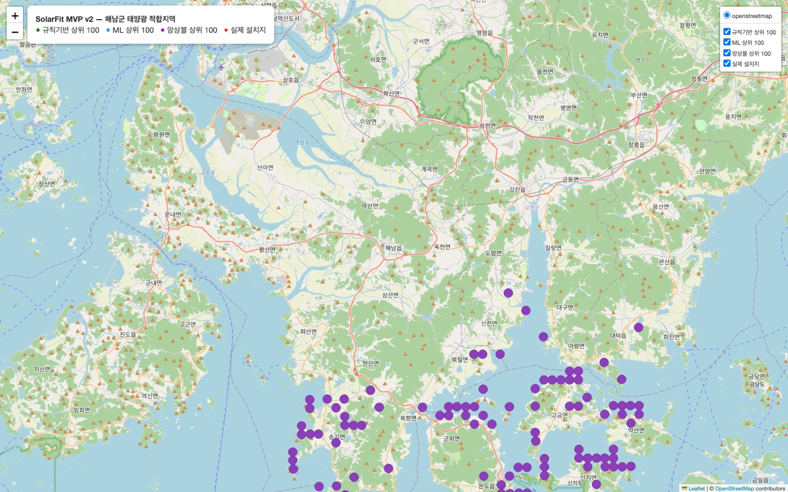

# 태양광·전력시장 창업 리서치 (2026)

"태양광 발전사업자를 위한 서비스"라는 창업 아이템을 데이터로 검증한 기록입니다. 한국 전력시장 데이터를 모아 계통 스트레스를 확인하고, 태양광 입지를 점수화하는 파이프라인과 위성 이미지 탐지 웹 MVP를 만들고, 중국 태양광 다운스트림 10년을 조사해 한국에 무엇이 통할지 정리했습니다.

[중국 리서치 PDF (한국어)](china-solar-downstream/docs/pdf/china-solar-downstream-2026-ko.pdf) · [English PDF](china-solar-downstream/docs/pdf/china-solar-downstream-2026.pdf)

## 한눈에 보기

| 항목 | 내용 |
| --- | --- |
| 기간 | 2026년 4월 ~ 5월, 리서치 개정 2026년 11월 |
| 주제 | 전력시장 데이터 분석, 태양광 입지 선별, 해외 시장 조사 |
| 한 일 | 공공 데이터 수집·정제, 가설 검증, 입지 점수화 파이프라인, 웹 MVP, 시장 리서치 |
| 도구 | Python(pandas, geopandas, XGBoost), FastAPI, PyTorch, React + TypeScript, Leaflet |

이 저장소는 네 부분으로 이루어져 있습니다.

| 폴더 | 무엇을 했나 | 규모 |
| --- | --- | --- |
| [`data/`](data/) | 전력수급, SMP, 수요, 플러스DR, 기상 데이터를 모아 시간 단위 분석 테이블로 정리 | 시간별 수요 87,648행, SMP 52,608행, DR 17,544행 |
| [`solar_mvp/`](solar_mvp/) | 해남군을 대상으로 한 입지 선별·점수화 파이프라인 | 수집부터 시각화까지 단계별 파이프라인, 개발용 격자 3,050칸으로 실행 |
| [`solarfit/`](solarfit/) | 위성 이미지에서 태양광 단지를 탐지하고 용량·매출을 추정하는 웹 서비스 | API 3개, 테스트 29개 |
| [`china-solar-downstream/`](china-solar-downstream/) | 중국 태양광 다운스트림 2016~2026 조사와 한국 적용 분석 | 기업 35곳, 분야 5개, 한·영 보고서 |

## 1. 전력시장 데이터로 계통 스트레스 확인

EPSIS·KPX 공개 자료와 기상 자료를 모아 시간 단위 테이블로 합친 뒤, 가설 여섯 개를 통계로 검증했습니다. 전체 결과는 [`processed_data_hypothesis_analysis.md`](data/docs/current/research/processed_data_hypothesis_analysis.md)에 있습니다.

| 가설 | 결과 |
| --- | --- |
| 주말 낮(11~15시) 수요는 평일 낮보다 낮다 | 평일 69,037MW, 주말 55,270MW (p < 0.0001) |
| 수요와 SMP는 같은 방향으로 움직인다 | Pearson r = 0.336 |
| DR이 활성화된 시간대는 SMP가 더 높다 (2020~2021) | 활성 82.4, 비활성 76.0 (p < 0.0001) |
| 기온과 수요의 관계는 직선보다 U자형이 잘 맞는다 | R² 0.004 → 0.259 |
| SMP가 0원인 시간은 주말 낮에 몰린다 | 25건 중 21건이 주말 낮 |
| 수요가 낮은 날은 예비율이 높다 | 하위 25% 42.4%, 상위 25% 19.8% |

읽어낸 것은 한 가지입니다. 계통의 부담은 한여름 최대 수요보다 **주말 낮의 낮은 수요와 가격 급락**에서 통계적으로 드러납니다. 태양광이 많이 돌 때 전기가 남는다는 뜻입니다.

같은 데이터로 지역별 출력제어 위험도 추정했습니다. 설비 대비 부하 비율과 실제 발전량을 합쳐 점수를 매기면 제주, 전남, 강원 순으로 높게 나옵니다 ([정리 문서](data/docs/current/research/지역별_출력제어_리스크_정리_20260427.md)).

주요 테이블은 [`data/processed/`](data/processed/)에 CSV로 있고, 목록과 범위는 [`data/README.md`](data/README.md)에 정리했습니다. 원자료를 정제하는 스크립트는 이 저장소에 포함돼 있지 않습니다.

## 2. 태양광 입지 선별 파이프라인 (`solar_mvp`)

전남 해남군을 대상으로, 100kW 이상 태양광을 놓을 만한 필지를 찾는 파이프라인입니다.

1. VWorld와 공공데이터에서 필지, 지목, 용도지역, 지형 자료를 수집합니다.
2. 지목, 규제 구역, 경사 15도, 표고 600m, 최소 면적 1,000㎡ 같은 조건으로 거릅니다.
3. 경사, 향, 일사량, 계통 접근성, 도로 접근성, 지가로 점수를 매깁니다.
4. 결과를 지도와 순위 목록으로 내보냅니다 ([`solar_mvp/output/`](solar_mvp/output/)).

정답 누출을 막는 테스트([`test_no_leakage.py`](solar_mvp/tests/test_no_leakage.py))를 두었고, 검증 리포트와 점수 비교 리포트를 HTML로 내보냅니다.

**저장소에 들어 있는 결과물은 실제 지적 필지가 아니라 개발용 격자로 돌린 실행 결과입니다.** 해남군 범위를 일정한 크기의 칸 3,050개로 나눠 파이프라인 전체가 끝까지 도는지 확인한 것이고, 이 중 1,815칸이 필터를 통과했습니다. 아래 지도의 점도 그 격자 칸이라, 실제 추천 필지로 읽으면 안 됩니다.



## 3. 위성 이미지 탐지 웹 MVP (`solarfit`)

지도에서 영역을 고르면 위성 타일을 내려받아 태양광 패널을 탐지하고, 단지별 면적·용량·예상 매출을 계산합니다. 매출은 면적당 용량, 연간 발전 시간, 단가를 고정값으로 둔 단순 추정입니다.

- **탐지**: DeepSolar-3M(ViT 기반 분류 모델)로 타일을 판정하고, 확신이 높은 타일에서 주변으로 넓혀 가며 단지를 묶습니다.
- **입지 분석**: 좌표 하나에 대해 일사량(NASA POWER), 고도·경사, 변전소 거리, 규제를 조회합니다.
- **구성**: FastAPI 백엔드, React + TypeScript + Leaflet 프런트엔드, 2D·3D 지도.

자세한 내용은 [`solarfit/README.md`](solarfit/README.md)에 있습니다.

## 4. 중국 태양광 다운스트림 리서치

중국의 주택용 설치, 금융·리스, 마켓플레이스, 운영·모니터링, 계통 통합 시장 10년을 기업 35곳 중심으로 조사하고 한국에 적용해 봤습니다.

**결론**: 돈이 나오는 곳이 '많이 설치하고 싼 돈을 붙이는 일'에서 '계통에 맞춰 움직이는 일'로 옮겨가고 있습니다. 한국은 중국의 보급 호황기가 아니라 그 이후 국면부터 맞고 있고, 병목은 수요나 자금이 아니라 계통입니다.

2026년 5월에 쓴 첫 판을 11월에 다시 검증했습니다. 한국 제도에 대한 오류와 기업 수치를 고치고, 근거가 약한 주장은 뺐습니다. 무엇을 고치고 버렸는지는 [최종 보고서](china-solar-downstream/docs/reports/final-report.md)와 [검증 기록](china-solar-downstream/data/raw/verification-2026-11.yaml)에 남겼습니다.

읽는 순서는 [`china-solar-downstream/README.md`](china-solar-downstream/README.md)에 있습니다.

## 배운 점과 한계

- **병목은 계통이었습니다.** 서로 다른 두 작업이 같은 곳을 가리켰습니다. 전력시장 데이터는 주말 낮의 공급 과잉을, 중국 사례는 보장 가격이 사라진 뒤 계통에 맞춰 움직이는 쪽으로 가치가 옮겨가는 모습을 보여 줬습니다.
- **입지 파이프라인은 실제 필지 데이터로 검증하지 못했습니다.** 저장소의 결과는 개발용 격자 실행이고, 기존 설치 위치 라벨도 0건이어서 머신러닝 검증이 성립하지 않아 규칙 기반 점수로 대체됐습니다. 리포트에 그 결과를 그대로 남겼습니다. 설치 위치 라벨은 위성 이미지 탐지로 만들 수 있는 부분입니다.
- **탐지 모델은 미국 데이터로 학습한 모델입니다.** 한국의 대규모 지상형 단지에서는 정확도가 떨어져, 주변 확장 방식으로 일부만 보완했습니다.
- **첫 리서치에는 오류가 있었습니다.** 한국에 이미 있던 제도를 없다고 본 것이 대표적입니다. 11월 개정에서 고쳤고, 기업 35곳 중 17곳은 새 공개 자료를 찾지 못해 재검증하지 못했다고 표시했습니다.
- **출력제어 위험 점수는 대용 지표입니다.** 실제 출력제어 기록이 아니라 설비·부하·발전량으로 추정한 값입니다.

## 실행

```bash
# 입지 파이프라인
cd solar_mvp && pip install -e ".[dev]" && cp .env.example .env   # VWorld, 공공데이터포털 키 필요
pytest

# SolarFit API
cd solarfit && pip install -r api/requirements.txt && cp .env.example .env
uvicorn api.main:app --reload
pytest

# SolarFit 웹
cd solarfit/web && npm install && npm run dev
```

SolarFit의 탐지 기능은 `DEEPSOLAR_HF_REPO` 환경변수에 모델 가중치가 있는 Hugging Face 저장소를 지정해야 동작합니다.

## 자료 출처

전력거래소(KPX), 전력통계정보시스템(EPSIS), 한국전력 공개 자료, 기상 관측 자료, Global Solar Atlas(Solargis·세계은행), VWorld, NASA POWER를 썼습니다. 중국 리서치의 출처와 등급 기준은 [`china-solar-downstream/docs/methodology/`](china-solar-downstream/docs/methodology/)에 있습니다.
